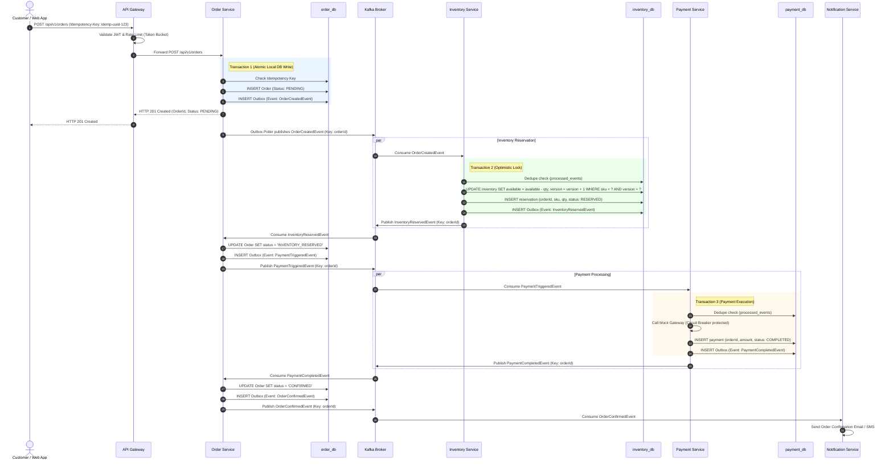
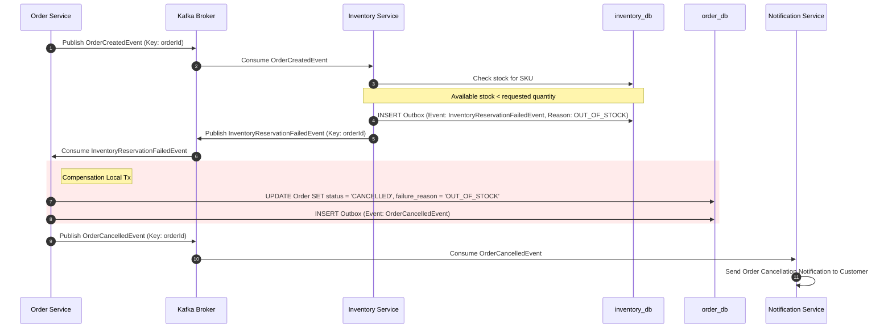
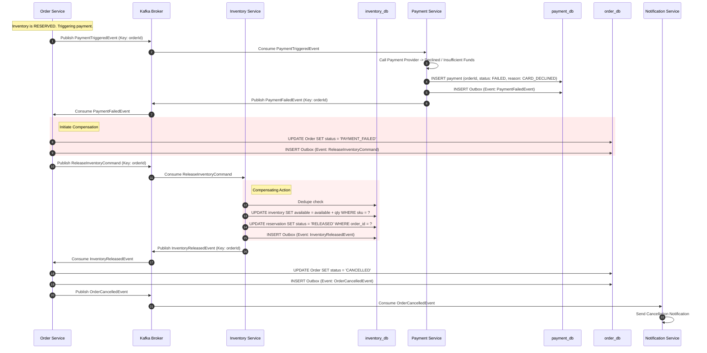
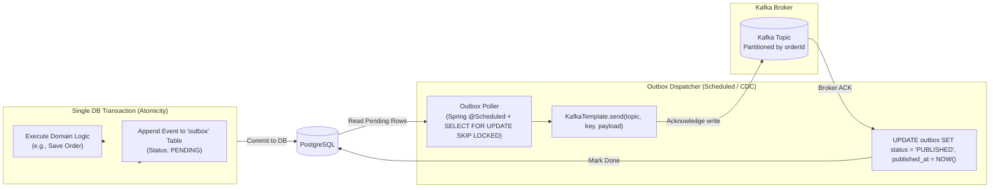

# System Architecture Specification

## 1. System Context & Overview

The **Order & Payments Platform** is a distributed, event-driven microservices architecture designed to handle e-commerce checkout, distributed transactions, inventory reservation, and payment processing with high resiliency, strict data consistency, and end-to-end observability.

```mermaid
flowchart TB
    subgraph Clients["Clients & External Systems"]
        WebClient["Web / Mobile App"]
        LoadGen["Load Generator (k6 / Gatling)"]
    end

    subgraph EdgeLayer["Edge / API Gateway (Port: 8080)"]
        Gateway["Spring Cloud Gateway"]
        AuthFilter["JWT Authentication Filter"]
        RateLimiter["Token-Bucket Rate Limiter"]
        RedisStore[("Redis (Rate Limiter & Gateway Cache)")]
    end

    subgraph CoreServices["Domain Microservices"]
        OrderService["order-service (Port: 8081)\n[Saga Orchestrator + State Tracker]"]
        InventoryService["inventory-service (Port: 8082)\n[Stock Reservation + Optimistic Lock]"]
        PaymentService["payment-service (Port: 8083)\n[Payment Engine + Resilience4j]"]
        NotificationService["notification-service (Port: 8084)\n[Event Consumer + Mock Dispatcher]"]
    end

    subgraph DataTier["Data Tier (PostgreSQL - Isolated Databases)"]
        OrderDB[("order_db\n(orders, outbox, idempotency)")]
        InventoryDB[("inventory_db\n(inventory, outbox, processed_events)")]
        PaymentDB[("payment_db\n(payments, outbox, processed_events)")]
        RedisCache[("Redis (Product & Inventory Cache)")]
    end

    subgraph MessagingTier["Event Streaming Tier (Apache Kafka)"]
        KafkaBroker["Kafka Broker Cluster"]
        TopicOrderEvents["orders.v1.events"]
        TopicInventoryEvents["inventory.v1.events"]
        TopicPaymentEvents["payments.v1.events"]
        TopicNotifications["notifications.v1.events"]
        TopicDLT["*.DLT (Dead Letter Topics)"]
    end

    subgraph ExternalProvider["External Systems"]
        MockBank["Payment Gateway Provider\n(Simulated with Latency & Chaos Injection)"]
    end

    subgraph ObservabilityStack["Observability & Diagnostics"]
        OTel["OpenTelemetry Collector / Agent"]
        Prometheus["Prometheus Metrics Scraper"]
        Grafana["Grafana Dashboards"]
        Jaeger["Jaeger Distributed Tracing"]
    end

    %% Client Routing
    WebClient -->|HTTPS / REST| Gateway
    LoadGen -->|REST Load| Gateway
    Gateway --> AuthFilter
    AuthFilter --> RateLimiter
    RateLimiter <-->|Token Balance Check| RedisStore

    %% Gateway to Downstream
    Gateway -->|Forward /api/v1/orders/**| OrderService
    Gateway -->|Forward /api/v1/inventory/**| InventoryService
    Gateway -->|Forward /api/v1/payments/**| PaymentService

    %% Microservice to DB
    OrderService <-->|Transactional Writes| OrderDB
    InventoryService <-->|Optimistic Locking| InventoryDB
    InventoryService <-->|Read Cache| RedisCache
    PaymentService <-->|Idempotent Writes| PaymentDB

    %% External Call
    PaymentService -->|Resilience4j Circuit Breaker| MockBank

    %% Transactional Outbox to Kafka
    OrderService -.->|Outbox Publisher| TopicOrderEvents
    InventoryService -.->|Outbox Publisher| TopicInventoryEvents
    PaymentService -.->|Outbox Publisher| TopicPaymentEvents
    
    %% Kafka Consumers
    TopicOrderEvents -->|Consume OrderCreated / Cancelled| InventoryService
    TopicInventoryEvents -->|Consume StockReserved / Failed| OrderService
    TopicOrderEvents -->|Consume Trigger Payment| PaymentService
    TopicPaymentEvents -->|Consume PaymentCompleted / Failed| OrderService
    TopicOrderEvents -->|Consume Order Status Updates| NotificationService
    TopicPaymentEvents -->|Consume Payment Events| NotificationService

    %% DLTs
    KafkaBroker -.-> TopicDLT

    %% Observability
    OrderService -.->|Traces & Metrics| OTel
    InventoryService -.->|Traces & Metrics| OTel
    PaymentService -.->|Traces & Metrics| OTel
    NotificationService -.->|Traces & Metrics| OTel
    Gateway -.->|Traces & Metrics| OTel
    OTel --> Prometheus
    OTel --> Jaeger
    Prometheus --> Grafana
```

---

## 2. Distributed Saga Workflow

We implement an **Orchestrated Saga** where the `order-service` acts as the Saga Orchestrator maintaining the state machine of each order (`PENDING` -> `INVENTORY_RESERVED` -> `PAYMENT_PROCESSED` -> `CONFIRMED`, or compensation states `CANCELLED` and `REFUNDED`).

### 2.1 Happy Path Flow (Success)

---

### 2.2 Compensating Flow 1: Insufficient Inventory (Out of Stock)

---

### 2.3 Compensating Flow 2: Payment Failure (Stock Release Required)

---

## 3. Transactional Outbox Pattern Details

To eliminate the **Dual-Write Problem** (where a local database write succeeds but publishing to Kafka fails, or vice-versa), every microservice writes its local state and outgoing event into the **same PostgreSQL database within a single ACID transaction**.

### Outbox Processing Characteristics
1. **Guaranteed At-Least-Once Delivery**: Events are never lost if the network or Kafka is down when the business transaction commits.
2. **Batch Polling with Concurrency Control**: We use `SELECT ... FOR UPDATE SKIP LOCKED` with limit (e.g., 50 rows) to allow multiple service instances to poll the outbox concurrently without race conditions or deadlocks.
3. **Partition Key Affinity**: All events for the same `orderId` use `orderId` as the Kafka message key. This guarantees strict in-order processing within a single Kafka partition for that order.
4. **Idempotent Consumers**: Downstream consumers enforce at-least-once deduplication using a `processed_events` table with unique event UUIDs.
